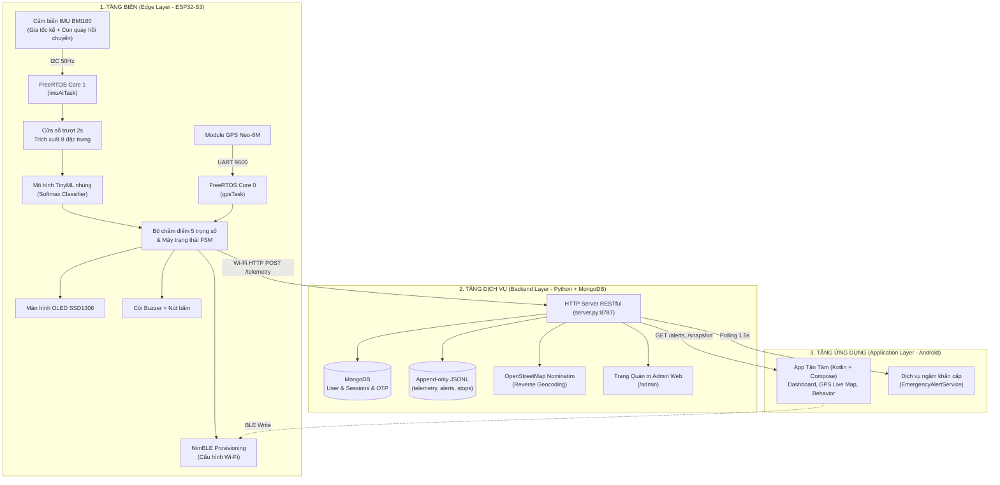
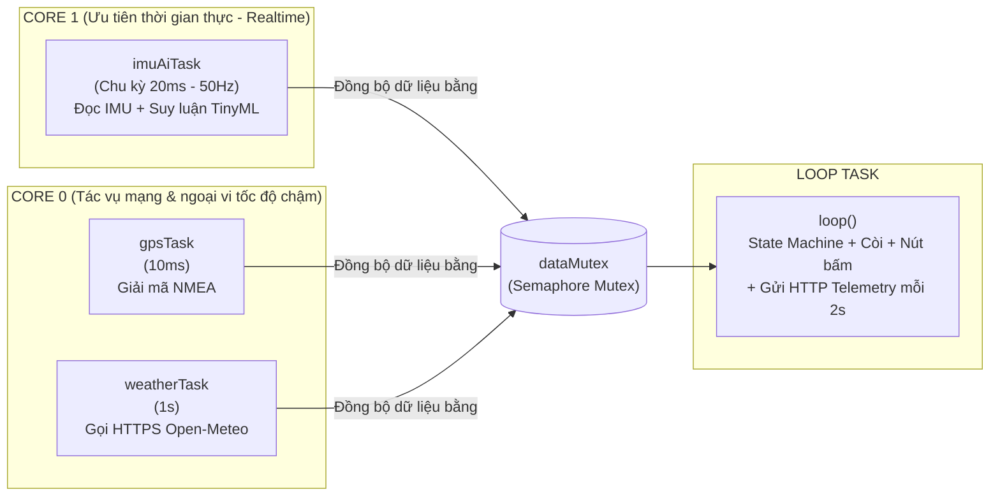
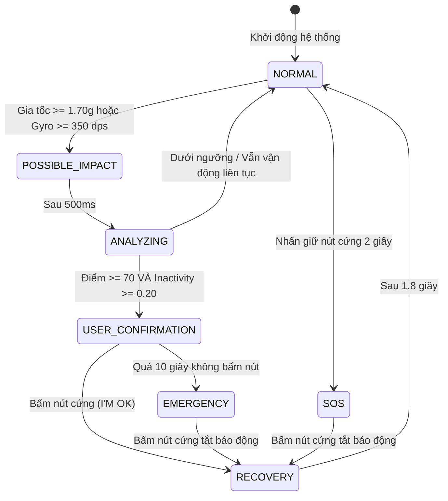

# BÁO CÁO KỸ THUẬT & HƯỚNG DẪN BẢO VỆ ĐỒ ÁN AIoT
## ĐỀ TÀI: THIẾT BỊ ĐEO TAY THÔNG MINH PHÁT HIỆN TÉ NGÃ VÀ CẢNH BÁO KHẨN CẤP THỜI GIAN THỰC (TẬN TÂM - SMART BAND AIoT)

---

## MỤC LỤC
1. [Tổng quan đề tài & Đặt vấn đề](#1-tổng-quan-đề-tài--đặt-vấn-đề)
2. [Kiến trúc tổng thể hệ thống (System Architecture)](#2-kiến-trúc-tổng-thể-hệ-thống-system-architecture)
3. [Thiết kế Phần cứng & Sơ đồ đấu nối (Hardware Layer)](#3-thiết-kế-phần-cứng--sơ-đồ-đấu-nối-hardware-layer)
4. [Lập trình Firmware & Đa nhiệm FreeRTOS (Firmware Layer)](#4-lập-trình-firmware--đa-nhiệm-freertos-firmware-layer)
5. [Quy trình xây dựng Mô hình Trí tuệ Nhân tạo Biên (TinyML Pipeline)](#5-quy-trình-xây-dựng-mô-hình-trí-tuệ-nhân-tạo-biên-tinyml-pipeline)
6. [Thuật toán phát hiện té ngã lai & Lọc báo động giả (Hybrid Fall Detection)](#6-thuật-toán-phát-hiện-té-ngã-lai--lọc-báo-động-giả-hybrid-fall-detection)
7. [Máy chủ Backend & Cơ sở dữ liệu (Backend Layer)](#7-máy-chủ-backend--cơ-sở-dữ-liệu-backend-layer)
8. [Ứng dụng Di động Android (Mobile Layer)](#8-ứng-dụng-di-động-android-mobile-layer)
9. [Kịch bản thực hiện Demo chấm điểm](#9-kịch-bản-thực-hiện-demo-chấm-điểm)
10. [Bộ câu hỏi phản biện của Giảng viên & Cách trả lời đạt điểm tối đa](#10-bộ-câu-hỏi-phản-biện-của-giảng-viên--cách-trả-lời-đạt-điểm-tối-đa)

---

## 1. TỔNG QUAN ĐỀ TÀI & ĐẶT VẤN ĐỀ

### 1.1. Bối cảnh & Lý do chọn đề tài
* **Thực trạng xã hội:** Dân số già hóa nhanh chóng, người cao tuổi thường ở nhà một mình khi con cái đi làm. Té ngã là nguyên nhân hàng đầu gây chấn thương nặng, đột quỵ và tử vong ở người cao tuổi nếu không được phát hiện kịp thời ("Thời gian vàng" cấp cứu là dưới 30 phút).
* **Hạn chế của giải pháp truyền thống:**
  * Các vòng đeo thông thường dùng ngưỡng gia tốc cố định $\rightarrow$ Cực kỳ dễ báo động giả khi vung tay, vỗ tay hoặc đi bộ.
  * Các giải pháp đẩy toàn bộ dữ liệu cảm biến lên Cloud để AI phân tích $\rightarrow$ Tốn băng thông, độ trễ cao, phụ thuộc Internet liên tục và xâm phạm quyền riêng tư.
* **Mục tiêu đề tài:** Chế tạo một thiết bị đeo tay thông minh tích hợp **Edge AI (TinyML)** chạy trực tiếp trên vi điều khiển ESP32-S3, kết hợp định vị GPS, còi báo động tại chỗ, truyền dữ liệu qua Wi-Fi/BLE lên Backend và App di động cảnh báo người thân trong vòng 10 giây.

---

## 2. KIẾN TRÚC TỔNG THỂ HỆ THỐNG (SYSTEM ARCHITECTURE)

Hệ thống được tổ chức theo mô hình **End-to-End AIoT 3 tầng**:



---

## 3. THIẾT KẾ PHẦN CỨNG & SƠ ĐỒ ĐẤU NỐI (HARDWARE LAYER)

### 3.1. Danh mục linh kiện phần cứng
1. **Vi điều khiển chính:** WEMOS LOLIN S3 Mini (ESP32-S3 Dual-Core Xtensa LX7 240MHz, 320KB SRAM, 4MB Flash, hỗ trợ phần cứng vector tăng tốc AI).
2. **Cảm biến chuyển động IMU 6 bậc tự do:** Bosch BMI160 (3 trục gia tốc kế $\pm 16\text{g}$ + 3 trục con quay hồi chuyển $\pm 2000^\circ/\text{s}$).
3. **Màn hình hiển thị:** OLED 0.96 inch SSD1306 (128x64 pixel, giao tiếp I2C).
4. **Định vị toàn cầu:** GPS u-blox Neo-6M kèm anten gốm.
5. **Cảnh báo âm thanh:** Còi Buzzer 5V Active.
6. **Tương tác vật lý:** Nút nhấn cơ học (Tactile Push Button) kèm điện trở kéo.

### 3.2. Sơ đồ đấu nối chân cố định ([`include/config.h`](file:///c:/Users/ngocl/Downloads/Smart_Band_AIoT/BOARD/include/config.h))

| Linh kiện | Chân linh kiện | Chân ESP32-S3 | Giao thức | Ghi chú |
| :--- | :--- | :--- | :--- | :--- |
| **BMI160 (IMU)** | SDA | **GPIO 6** | I2C (Bus 0) | Địa chỉ I2C: `0x68` (tần số 400kHz) |
| | SCL | **GPIO 7** | I2C (Bus 0) | Cảm biến chuyển động chính |
| **OLED 0.96"** | SDA | **GPIO 9** | I2C (Bus 1) | Tách riêng Bus I2C để tránh nghẽn băng thông với IMU |
| | SCL | **GPIO 8** | I2C (Bus 1) | Địa chỉ I2C: `0x3C` |
| **Còi Buzzer** | (+) | **GPIO 5** | Digital Output | Phát âm thanh ngắt quãng (hỏi thăm) & liên tục (khẩn cấp) |
| **Nút bấm** | Chân tín hiệu | **GPIO 4** | Digital Input | Nhấn nhả: Hủy báo động / Giữ 2s: Báo động SOS |
| **GPS Neo-6M** | TX | **GPIO 2 (RX1)** | HardwareSerial 1 | Baudrate: 9600 bps |
| | RX | **GPIO 1 (TX1)** | HardwareSerial 1 | NMEA sentences |
| **Nguồn cấp** | VCC / GND | 3.3V / 5V / GND | Power | Nguồn ổn định từ USB hoặc pin sạc |

---

## 4. LẬP TRÌNH FIRMWARE & ĐA NHIỆM FREERTOS (FIRMWARE LAYER)

Thay vì viết code tuần tự trong hàm `loop()` khiến việc đọc GPS hay gọi HTTP làm "đóng băng" cảm biến, dự án sử dụng **FreeRTOS tận dụng cả 2 nhân của ESP32-S3**:



* **`imuAiTask` (Core 1 - Ưu tiên mức 2):** Đảm bảo chu kỳ lấy mẫu 50Hz chính xác tuyệt đối bằng hàm `vTaskDelayUntil()`. Đây là tác vụ quan trọng nhất để AI không bị mất mẫu chuyển động.
* **`gpsTask` (Core 0 - Ưu tiên mức 2):** Đọc luồng ký tự liên tục từ cổng UART1 và nạp vào thư viện `TinyGPSPlus`.
* **`weatherTask` (Core 0 - Ưu tiên mức 1):** Tự động đồng bộ thời tiết từ API `Open-Meteo` qua HTTPS theo toạ độ GPS thực tế.
* **Cơ chế BLE Provisioning:** Khi vòng tay chưa có Wi-Fi, bo mạch tự phát Bluetooth tên `Smartband-001`. App trên điện thoại kết nối BLE để gửi SSID, Password và IP Server, lưu an toàn vào bộ nhớ Flash NVS.

---

## 5. QUY TRÌNH XÂY DỰNG MÔ HÌNH TRÍ TUỆ NHÂN TẠO BIÊN (TINYML PIPELINE)

Quy trình huấn luyện AI không dùng các công cụ tự động Black-box mà được xây dựng từ đầu bằng Python:

### Bước 1: Thu thập tập dữ liệu thực tế ([`tools/collect_dataset.py`](file:///c:/Users/ngocl/Downloads/Smart_Band_AIoT/BOARD/tools/collect_dataset.py))
Dùng script Python bắt luồng dữ liệu 50Hz từ cổng Serial của kit để ghi ra file CSV gồm 8 cột: `timestamp, ax, ay, az, gx, gy, gz, label`.
Gán 3 nhãn chuẩn:
* `normal`: Đứng yên, đi bộ, vung tay, gõ bàn phím, ngồi xuống.
* `impact`: Va đập tay nhẹ, đập bàn, vỗ tay.
* `crash`: Rơi tự do, va chạm mạnh mô phỏng té ngã.

### Bước 2: Cửa sổ trượt & Trích xuất 8 đặc trưng toán học ([`tools/train_tinyml_model.py`](file:///c:/Users/ngocl/Downloads/Smart_Band_AIoT/BOARD/tools/train_tinyml_model.py))
Thay vì đưa dữ liệu thô vào AI (quá nặng cho vi điều khiển), dữ liệu được gom thành **Cửa sổ trượt 100 mẫu (2 giây), bước nhảy 25 mẫu (0.5 giây)** để trích xuất 8 đặc trưng nén:
1. `acc_mean`: Độ lớn gia tốc trung bình $\bar{a}$.
2. `acc_std`: Độ lệch chuẩn gia tốc $\sigma_a$ (đo độ biến động năng lượng chuyển động).
3. `acc_peak_linear`: Đỉnh gia tốc tuyến tính tách trọng lực $|a - 1g|$.
4. `gyro_mean`: Vận tốc góc trung bình.
5. `gyro_peak`: Vận tốc góc cực đại khi xoay người $\omega_{\max}$.
6. `orientation_delta`: Độ biến thiên góc nghiêng không gian:
   $$\Delta \text{Angle} = \sqrt{(\text{Pitch}_t - \text{Pitch}_0)^2 + (\text{Roll}_t - \text{Roll}_0)^2}$$
7. `inactivity_ratio`: Tỷ lệ thời gian bất động sau chấn động.
8. `jerk_peak`: Độ giật gia tốc cực đại $\max\left(\frac{|a_t - a_{t-1}|}{\Delta t}\right)$ (chỉ số chấn động đặc trưng của va chạm).

### Bước 3: Huấn luyện & Xuất mã C++ nhúng ([`include/generated_model.h`](file:///c:/Users/ngocl/Downloads/Smart_Band_AIoT/BOARD/include/generated_model.h))
* Huấn luyện mô hình **Multinomial Logistic Regression with Softmax** kết hợp chuẩn hoá `StandardScaler` (Mean & Scale).
* Xuất trực tiếp ma trận trọng số $W_{3 \times 8}$ và bias $B_3$ thành mảng `const float` trong file header C++.
* **Ưu điểm vượt trội:**
  * Kích thước mô hình: **$< 1\text{ KB}$ Flash**.
  * Thời gian suy luận trên ESP32-S3: **$< 150 \mu\text{s}$ (micro-giây)**.
  * Không phụ thuộc bất kỳ thư viện AI cồng kềnh nào (như TensorFlow Lite hay ONNX).

---

## 6. THUẬT TOÁN PHÁT HIỆN TÉ NGÃ LAI & LỌC BÁO ĐỘNG GIẢ (HYBRID FALL DETECTION)

Hệ thống kết hợp cả **Mô hình AI** và **Quy tắc vật lý đa cảm biến (Sensor Fusion)** với công thức chấm điểm 5 trọng số:

$$\text{CrashScore} = 40\% \cdot S_{\text{AI}} + 25\% \cdot S_{\text{Impact}} + 15\% \cdot S_{\text{Rotation}} + 10\% \cdot S_{\text{Orient}} + 10\% \cdot S_{\text{Inactivity}}$$

### 6.1. Máy trạng thái an toàn (Finite State Machine - FSM)



### 6.2. Cơ chế lọc báo động giả khi đi bộ vung tay (Đã tối ưu)
* **Chốt chặn 1 (Ngưỡng kích hoạt):** `POSSIBLE_IMPACT_LINEAR_G = 1.70g`. Vung tay bình thường chỉ đạt tối đa $1.2\text{g} - 1.5\text{g}$, hoàn toàn không đánh thức bộ phân tích.
* **Chốt chặn 2 (Kiểm tra bất động - Inactivity Guard):**
  ```cpp
  if (currentEvidence.inactivityRatio < 0.20f && bestAiCrashProbability_ < 0.85f) {
      return false; // Người đeo vẫn đang vung tay bước đi liên tục -> HỦY BÁO ĐỘNG NGAY
  }
  ```
* **Chốt chặn 3 (Vòng hỏi thăm 10 giây):** Cho phép người dùng bấm nút hủy nếu chỉ là va quẹt nhẹ vô hại trước khi hệ thống báo động cho người thân.

---

## 7. MÁY CHỦ BACKEND & CƠ SỞ DỮ LIỆU (BACKEND LAYER)

* **Công nghệ:** Python 3 Native `ThreadingHTTPServer`, MongoDB 7.0.
* **RESTful Endpoints chính:**
  * `POST /api/v1/telemetry`: Tiếp nhận luồng dữ liệu thiết bị (toạ độ GPS, trạng thái AI, pin, Wi-Fi).
  * `GET /api/v1/alerts`: Trả về danh sách cảnh báo SOS và té ngã mới nhất.
  * `GET /api/v1/devices/{id}/snapshot`: Lấy trạng thái thời gian thực của vòng tay.
  * `POST /api/v1/auth/...`: Đăng ký, đăng nhập, xác thực mã OTP gửi về.
* **Tính năng thông minh - Tự động nhận diện điểm dừng chân (Stop Detection):**
  * Khi tốc độ GPS $< 2\text{ km/h}$ trong bán kính $20\text{m}$ liên tục quá 3 phút $\rightarrow$ Server tự động gọi API `OpenStreetMap Nominatim Reverse Geocoding` để chuyển toạ độ thành địa chỉ đường phố cụ thể (ví dụ: *"Đường Hoàng Quốc Việt, Cầu Giấy"*) và ghi vào nhật ký hành trình.
* **Giao diện Web Admin (`/admin`):** Quản trị viên sử dụng khóa bảo mật `admin.key` để quản lý người dùng, xem dữ liệu viễn trắc và khoá tài khoản khẩn cấp.

---

## 8. ỨNG DỤNG DI ĐỘNG ANDROID (MOBILE LAYER)

* **Công nghệ:** Android SDK 35, ngôn ngữ **Kotlin**, giao diện **Jetpack Compose (Material 3)**.
* **Tính năng chính:**
  1. **Dashboard:** Xem nhanh trạng thái sức khỏe, pin, mạng và hành vi AI thời gian thực.
  2. **Bản đồ trực tiếp (Live Tracking Screen):** Hiển thị toạ độ GPS của người già trên Google Maps, tích hợp **Vùng an toàn (Geofence bán kính 250m)** quanh nhà riêng và cảnh báo khi đi xa.
  3. **Behavior AI Screen:** Vẽ biểu đồ gia tốc/con quay thời gian thực và phân tích xác suất hành vi (Đi bộ, Đứng, Ngồi, Ngã).
  4. **Dịch vụ chạy ngầm khẩn cấp ([`EmergencyAlertService.kt`](file:///c:/Users/ngocl/Downloads/Smart_Band_AIoT/BOARD/program/android-app/app/src/main/java/com/smartband/iotcare/EmergencyAlertService.kt)):**
     * Chạy dưới dạng Android Foreground Service liên tục thăm dò tín hiệu từ backend.
     * Khi có sự kiện `FALL` hoặc `SOS`, service lập tức phát còi hụ cảnh báo âm lượng tối đa và rung mạnh theo nhịp khẩn cấp để đánh thức người nhà.

---

## 9. KỊCH BẢN THỰC HIỆN DEMO CHẤM ĐIỂM

Để buổi báo cáo diễn ra trơn tru và thuyết phục nhất trước hội đồng chấm:

### Kịch bản 1: Chứng minh khả năng "Chống báo động giả"
* Cầm bảng mạch trên tay, vừa đi lại vừa vung tay bình thường, lắc qua lắc lại trước mặt thầy cô.
* **Thuyết minh:** *"Như thầy cô thấy, dù em vung tay và di chuyển liên tục, hệ thống đã lọc bằng ngưỡng 1.7g và thuật toán kiểm tra tính liên tục của vận động, vòng tay hoàn toàn không bị báo động nhầm."*

### Kịch bản 2: Biểu diễn "Phát hiện té ngã thật" (Dùng bảng mạch an toàn)
* Đặt một cuốn sổ tay dày hoặc tấm lót chuột trên bàn.
* Nhấc bảng mạch lên cao $\approx 20\text{cm}$, **gõ dứt khoát góc mạch xuống cuốn sổ, lật nghiêng bảng mạch $\ge 50^\circ$ và thả tay ra để mạch nằm yên trên bàn**.
* **Quan sát:** Màn hình OLED lập tức phát tiếng bíp và đếm ngược **"ARE YOU OK? 10"**.
* **Thuyết minh:** *"Hệ thống nhận diện được xung lực va chạm kết hợp sự đổi tư thế và trạng thái bất động sau ngã. Vòng tay đang đếm ngược 10 giây để người đeo có cơ hội bấm nút hủy nếu họ vẫn an toàn."*
* **Sau 10 giây không ai bấm:** Còi trên bo mạch hú liên tục, điện thoại để trên bàn lập tức reo chuông báo động khẩn cấp và Google Maps cập nhật vị trí ngã!

### Kịch bản 3: Biểu diễn "Nút bấm SOS khẩn cấp"
* Nhấn giữ nút cơ trên mạch trong 2 giây $\rightarrow$ OLED hiện chữ `SOS`, điện thoại lập tức nhận thông báo khẩn cấp tức thì.

---

## 10. BỘ CÂU HỎI PHẢN BIỆN CỦA GIẢNG VIÊN & CÁCH TRẢ LỜI "ĂN ĐIỂM"

#### ❓ Câu hỏi 1: Tại sao nhóm không gửi dữ liệu thô lên Cloud để Server chạy AI xịn hơn mà lại dùng TinyML trên ESP32?
> **Trả lời "ăn điểm":**
> *"Dạ thưa thầy/cô, việc dùng **Edge AI (TinyML)** tại biên đem lại 3 ưu thế vượt trội:
> 1. **Thời gian đáp ứng (Zero Latency):** Phản ứng tức thì trong vòng micro-giây mà không phụ thuộc vào độ trễ mạng Internet.
> 2. **Tính độc lập & an toàn:** Nếu người đeo ngã ở khu vực sóng yếu hoặc mất mạng, còi báo động tại chỗ và máy trạng thái trên vòng tay vẫn tự kích hoạt để cầu cứu người xung quanh.
> 3. **Tiết kiệm năng lượng & băng thông:** Nếu gửi liên tục 50Hz (50 mẫu/giây với 6 trục float) lên Server thì pin thiết bị sẽ cạn kiệt trong 30 phút và làm nghẽn băng thông mạng."*

#### ❓ Câu hỏi 2: Tại sao nhóm lại kết hợp cả AI và Quy tắc trọng số (Rule-based) mà không để AI quyết định 100%?
> **Trả lời "ăn điểm":**
> *"Dạ, trong các hệ sinh thái thiết bị đeo y tế, không bao giờ người ta tin tưởng 100% vào một mô hình AI độc lập vì AI luôn có xác suất ngoại lai (Edge-case misclassification). Nhóm xây dựng thuật toán lai (Hybrid): AI đóng góp 40% điểm số tin cậy, 60% còn lại đến từ các định luật vật lý thực tế (gia tốc đỉnh, vận tốc góc xoay, góc nghiêng cơ thể và tỷ lệ bất động). Sự kết hợp này giúp hệ thống vừa có tính thông minh thích nghi của AI, vừa có tính tin cậy tuyệt đối của các ngưỡng vật lý."*

#### ❓ Câu hỏi 3: Nếu người già bị ngã nhưng sau đó vẫn cử động được thì hệ thống có bỏ sót không?
> **Trả lời "ăn điểm":**
> *"Dạ thưa thầy/cô, hoàn toàn không bị bỏ sót. Ngưỡng bất động `inactivityRatio >= 0.20` trong cửa sổ 2.5 giây thực chất chỉ yêu cầu người đó có độ khựng lại khoảng **0.5 giây**. Khi ngã xuống đất, phản xạ sinh lý của con người luôn có một khoảng trễ giật mình từ 0.5s - 1.5s trước khi bắt đầu cựa quậy ngồi dậy. Sau 0.5s đó, dù họ có cựa quậy thì hệ thống đã chuyển sang chế độ đếm ngược 10 giây hỏi thăm rồi ạ."*

#### ❓ Câu hỏi 4: Nhóm sử dụng FreeRTOS đa nhiệm để giải quyết bài toán gì?
> **Trả lời "ăn điểm":**
> *"Dạ, ESP32-S3 là vi điều khiển 2 nhân. Nếu chạy tuần tự (single-thread), các tác vụ như đợi tín hiệu GPS từ UART hay gọi HTTP Post lên Server sẽ mất từ 100ms - 1500ms, khiến việc đọc cảm biến IMU bị gián đoạn, làm rách cửa sổ dữ liệu của AI. Nhóm đã ghim `imuAiTask` chạy độc lập trên **Core 1** với chu kỳ chuẩn xác 50Hz, trong khi GPS và Wi-Fi chạy trên **Core 0**, đồng bộ dữ liệu bằng `Mutex Semaphore`."*

#### ❓ Câu hỏi 5: Hướng phát triển của sản phẩm này sau đồ án là gì?
> **Trả lời "ăn điểm":**
> *"Dạ, nhóm có 3 hướng hoàn thiện để thương mại hóa:
> 1. Tích hợp module 4G LTE-M / NB-IoT hoặc chế độ BLE Companion để gửi tin ngoài đường khi không có Wi-Fi nhà.
> 2. Bổ sung cảm biến khí áp kế (Barometer BMP280) để đo chính xác độ rơi độ cao từ $1.2\text{m}$ xuống sàn.
> 3. Tối ưu chế độ ngủ sâu (Light Sleep / Tilt-to-wake) để kéo dài thời lượng pin đạt trên 24 giờ."*
