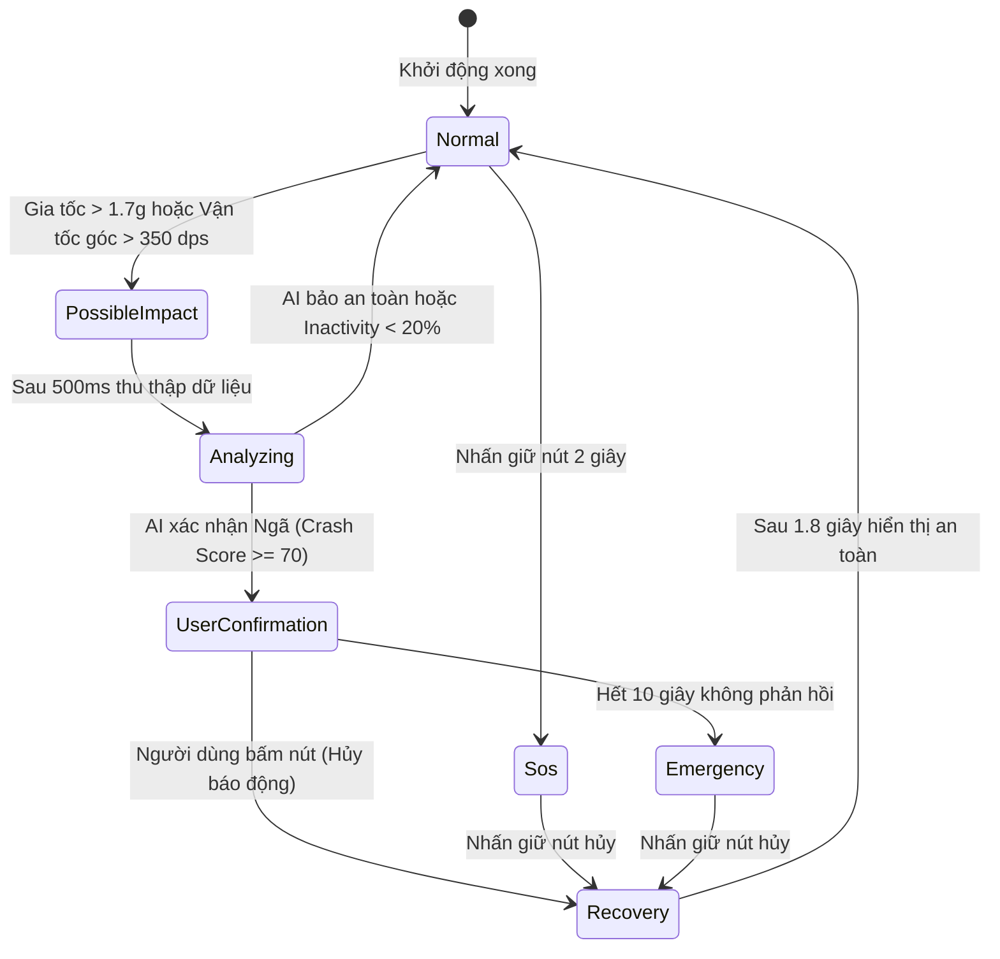

# GIÁO TRÌNH LÝ THUYẾT TOÀN DIỆN DỰ ÁN SMART BAND AIoT
**Hệ thống Vòng đeo tay Thông minh Giám sát Sức khỏe & Cảnh báo Tai nạn Khẩn cấp sử dụng Trí tuệ Nhân tạo Nhúng (TinyML)**

---

## MỤC LỤC
1. [Chương 1: Nền tảng Phần cứng & Vi điều khiển Nhúng](#chuong-1-nen-tang-phan-cung--vi-dieu-khien-nhung)
2. [Chương 2: Cảm biến Quán tính & Vật lý Động lực học Tai nạn](#chuong-2-cam-bien-quan-tinh--vat-ly-dong-luc-hoc-tai-nan)
3. [Chương 3: Trí tuệ Nhân tạo Nhúng (TinyML & Pattern Recognition)](#chuong-3-tri-tue-nhan-tao-nhung-tinyml--pattern-recognition)
4. [Chương 4: Hệ điều hành Thời gian thực (FreeRTOS) & Máy trạng thái (FSM)](#chuong-4-he-dieu-hanh-thoi-gian-thuc-freertos--may-trang-thai-fsm)
5. [Chương 5: Giao thức Truyền thông Không dây (BLE & Wi-Fi IoT)](#chuong-5-giao-thuc-truyen-thong-khong-day-ble--wi-fi-iot)
6. [Chương 6: Kiến trúc Hệ thống Backend & Ứng dụng Di động Android](#chuong-6-kien-truc-he-thong-backend--ung-dung-di-dong-android)
7. [Chương 7: Tổng hợp Công thức, Bảng tra cứu & Câu hỏi Vấn đáp](#chuong-7-tong-hop-cong-thuc-bang-tra-cuu--cau-hoi-van-dap)

---

# CHƯƠNG 1: NỀN TẢNG PHẦN CỨNG & VI ĐIỀU KHIỂN NHÚNG

## 1.1. Vi điều khiển ESP32-S3
ESP32-S3 là hệ thống trên vi mạch (SoC - System on Chip) 32-bit của Espressif Systems, được thiết kế chuyên biệt cho các bài toán **AIoT (Trí tuệ nhân tạo vạn vật)**:

* **Vi kiến trúc:** Lõi kép Xtensa® Dual-core 32-bit LX7, xung nhịp hoạt động cấu hình từ $80\text{ MHz}$ đến $240\text{ MHz}$.
* **Bộ chỉ lệnh mở rộng tăng tốc AI (Vector Instructions):** Hỗ trợ tập lệnh SIMD (Single Instruction Multiple Data), cho phép thực hiện song song các phép nhân tích lũy (MAC - Multiply-Accumulate), tăng tốc độ tính toán cho mạng nơ-ron gấp 3 - 4 lần so với ESP32 đời đầu.
* **Bộ nhớ:**
  * **SRAM nội:** $512\text{ KB}$ (trong đó khoảng $320\text{ KB}$ khả dụng cho vùng nhớ Heap/Stack của ứng dụng).
  * **ROM:** $384\text{ KB}$ chứa mã nguồn khởi động (Bootloader) và các hàm hệ thống cốt lõi.
  * **External Flash:** $4\text{ MB}$ (giao tiếp qua chuẩn Quad-SPI / Octal-SPI) dùng để chứa chương trình biên dịch (Firmware), bảng phân vùng (Partition Table) và vùng lưu trữ dữ liệu cố định (NVS).
* **NVS (Non-Volatile Storage):** 
  * Cơ chế lưu trữ dạng cặp khóa - giá trị (Key-Value) trên bộ nhớ Flash.
  * Ứng dụng trong dự án: Lưu trữ SSID/Mật khẩu Wi-Fi cấu hình qua BLE, nội dung tùy biến màn hình (`screen1`, `screen2`, `screen3`). Dữ liệu này không bị mất đi khi ngắt nguồn điện.

---

## 1.2. Các chuẩn giao tiếp phần cứng (Buses & Protocols)

### 1. I2C (Inter-Integrated Circuit)
Chuẩn truyền thông nối tiếp 2 dây đồng bộ, thiết kế bởi Philips Semiconductors (nay là NXP):
* **2 đường tín hiệu:**
  * `SDA` (Serial Data): Đường truyền dữ liệu hai chiều.
  * `SCL` (Serial Clock): Đường truyền xung nhịp đồng bộ do vi điều khiển (Master) phát ra.
* **Cơ chế hoạt động:**
  * **Điện trở kéo lên (Pull-up Resistors):** Cả 2 chân `SDA` và `SCL` hoạt động theo cấu hình hở cực thu (Open-drain), bắt buộc phải có điện trở kéo lên nguồn ($3.3\text{V}$, thường từ $2.2\text{ k}\Omega$ đến $4.7\text{ k}\Omega$).
  * **Định địa chỉ 7-bit:** Mỗi thiết bị ngoại vi trên bus có một địa chỉ cứng duy nhất.
    * Màn hình OLED SSD1306: Địa chỉ `0x3C`.
    * Cảm biến IMU BMI160: Địa chỉ `0x68` (hoặc `0x69` nếu chân SDO nối lên VCC).
  * **Khung truyền:** Tín hiệu Start $\rightarrow$ Byte địa chỉ + Bit Read/Write $\rightarrow$ Bit ACK/NACK $\rightarrow$ Byte dữ liệu $\rightarrow$ Bit ACK/NACK $\rightarrow$ Tín hiệu Stop.
* **Tốc độ:** Chuẩn Fast Mode đạt $400\text{ kHz}$ (trong dự án dùng để đọc cảm biến quán tính mượt mà ở chu kỳ 20ms).

### 2. UART (Universal Asynchronous Receiver-Transmitter)
Chuẩn truyền thông nối tiếp bất đồng bộ, dùng để giao tiếp với module GPS:
* **2 đường tín hiệu:** `TX` (Transmitter - Truyền đi) và `RX` (Receiver - Nhận về). Nguyên tắc đấu nối: `TX_Module` $\rightarrow$ `RX_ESP32` và `RX_Module` $\leftarrow$ `TX_ESP32`.
* **Bất đồng bộ (Asynchronous):** Không có dây xung nhịp chung; hai bên thống nhất một tốc độ truyền ký hiệu gọi là **Baudrate** (ở dự án này là $9600\text{ bps}$ cho GPS và $115200\text{ bps}$ cho Serial Monitor nạp code/debug).
* **Định dạng khung:** 1 Start bit $\rightarrow$ 8 Data bits $\rightarrow$ No Parity $\rightarrow$ 1 Stop bit (8N1).

### 3. GPIO & Chống rung phím (Software Debounce)
* **Nguyên lý nút bấm:** Chân nút bấm cấu hình `INPUT_PULLUP`. Khi không bấm, chân ở mức `HIGH` ($3.3\text{V}$). Khi bấm nút chạm đất (GND), chân tụt xuống mức `LOW` ($0\text{V}$).
* **Hiện tượng Rung phím (Contact Bouncing):** Khi nhấn lá đồng cơ học, tiếp điểm dao động cơ học sinh ra chuỗi xung điện áp hỗn loạn trong $5 - 20\text{ ms}$, khiến vi điều khiển lầm tưởng là người dùng bấm liên tục hàng chục lần.
* **Giải thuật Chống rung phần mềm (Software Debounce bằng `millis()`):**
  $$t_{\text{hiện tại}} - t_{\text{lần đổi mức cuối}} > \Delta t_{\text{debounce}} \quad (\Delta t \approx 50\text{ ms})$$
  Chỉ khi mức logic ổn định vượt quá thời gian $\Delta t$ thì mới chấp nhận sự kiện bấm phím.
* **Phân biệt Click ngắn và Nhấn giữ (Long Press):**
  * $T_{\text{nhấn}} < 1.5\text{ giây}$: Short Click (Xác nhận an toàn / Chuyển màn hình).
  * $T_{\text{nhấn}} \ge 2.0\text{ giây}$: Long Press (Kích hoạt SOS khẩn cấp).

---

## 1.3. Còi Buzzer & Mạch kích công suất
* **Còi chủ động (Active Buzzer):** Bên trong đã tích hợp sẵn mạch dao động âm tần. Chỉ cần cấp mức điện áp `HIGH` ($3.3\text{V} - 5\text{V}$) là còi tự phát ra âm thanh tần số cố định (khoảng $2.5\text{ kHz}$). Điều khiển bằng hàm `digitalWrite(BUZZER_PIN, HIGH/LOW)`.
* **Còi thụ động (Passive Buzzer):** Không có mạch tạo dao động nội. Cần vi điều khiển cấp chuỗi xung PWM tần số mong muốn (dùng hàm `ledcWriteTone()`) thì màng loa mới rung phát ra tiếng.
* **Định luật Ohm và giới hạn dòng điện GPIO:**
  * Chân GPIO vi điều khiển chỉ chịu được dòng tối đa khoảng $20 - 40\text{ mA}$.
  * Nếu dùng còi công suất lớn đòi hỏi dòng $> 80\text{ mA}$, phải sử dụng mạch kích qua Transistor NPN (S8050, 2N2222) hoặc MOSFET kênh N.

---

# CHƯƠNG 2: CẢM BIẾN QUÁN TÍNH & VẬT LÝ ĐỘNG LỰC HỌC TAI NẠN

```
     Z (Hướng lên trên mặt đồng hồ)
     ^
     |   Y (Dọc theo cổ tay)
     |  /
     | /
     +-----> X (Ngang cổ tay)
```

## 2.1. Cảm biến IMU 6 bậc tự do (BMI160)
Cảm biến IMU (Inertial Measurement Unit) tích hợp 2 thành phần vi cơ điện tử (MEMS):

### 1. Gia tốc kế 3 trục (3-Axis Accelerometer)
* **Nguyên lý:** Cấu trúc vi cơ có khối lượng tĩnh $m$ gắn trên các vi lò xo điện dung. Khi vi điều khiển chịu gia tốc, quán tính làm khối lượng dịch chuyển so với các bản cực cố định, làm thay đổi điện dung $C$:
  $$F = m \cdot a = k \cdot \Delta x \implies \Delta C \propto a$$
* **Dải đo (Range):** Cấu hình $\pm 4g$ (với $1g \approx 9.81\text{ m/s}^2$). Ở dải này, độ nhạy là $8192\text{ LSB/g}$.
* **Đo được gia tốc tĩnh:** Khi nằm yên trên bàn, trục hướng lên trời luôn chịu lực hấp dẫn của Trái Đất, cho giá trị đo bằng $+1.0g$.

### 2. Con quay hồi chuyển 3 trục (3-Axis Gyroscope)
* **Nguyên lý:** Dựa trên **Hiệu ứng Coriolis**. Khi một khối vi cơ đang dao động với vận tốc $v$ trong hệ quy chiếu quay với vận tốc góc $\omega$, nó sẽ chịu một lực Coriolis trực giao:
  $$\vec{F}_{\text{Coriolis}} = -2m (\vec{\omega} \times \vec{v})$$
* **Dải đo:** Cấu hình $\pm 1000^\circ/\text{s}$ (dps - degrees per second). Độ nhạy $32.8\text{ LSB/dps}$.
* **Công dụng:** Đo tốc độ xoay góc của bàn tay và cơ thể khi mất thăng bằng.

---

## 2.2. Động lực học các pha của một vụ ngã / tai nạn (Fall Dynamics)
Vật lý của một cú ngã ở người gồm **4 pha liên tiếp rõ rệt trong miền thời gian**:

```
Gia tốc (g)
  ^
4g|                                  [PHA 2: VA CHẠM ĐỘT NGỘT]
  |                                     Peak > 2.5g - 4.0g
3g|                                            /\
  |                                           /  \
2g|                                          /    \
  |   [PHA 0: BÌNH THƯỜNG]                  /      \          [PHA 3: BẤT ĐỘNG HOÀN TOÀN]
1g|~~~~~~~~~~~~~~\                         /        \              Độ biến thiên std ~ 0
  |               \                       /          \--------------------------------
0g|                \                     /
  +-----------------\                   /--------------------------------------------> Thời gian (t)
                     \                 /
                      \_______________/
                   [PHA 1: RƠI TỰ DO]
                     Freefall < 0.5g
```

### Pha 0: Tiền va chạm / Trạng thái bình thường (Pre-fall)
Cơ thể đi lại, sinh hoạt. Gia tốc toàn phần dao động quanh mức $1.0g$.

### Pha 1: Mất thăng bằng & Rơi tự do (Free-fall Phase)
Khi chân vấp ngã hoặc xe mất thăng bằng, cơ thể rơi xuống theo phương trọng lực. Lúc này gia tốc biểu kiến sụt giảm mạnh về gần 0:
$$A_{\text{total}} = \sqrt{a_x^2 + a_y^2 + a_z^2} < 0.5g \quad (\text{kéo dài } 100 - 300\text{ ms})$$

### Pha 2: Va chạm mặt đất (Impact Phase)
Bộ phận cơ thể hoặc cánh tay đập xuống đất hoặc chướng ngại vật. Sự giảm tốc đột ngột sinh ra phản lực cực lớn:
$$A_{\text{total}} \ge 2.5g - 5.0g$$
Đồng thời, cánh tay xoay lắc dữ dội khi cố gắng chống đỡ:
$$\Omega_{\text{total}} = \sqrt{\omega_x^2 + \omega_y^2 + \omega_z^2} \ge 350^\circ/\text{s} - 500^\circ/\text{s}$$

### Pha 3: Thay đổi tư thế & Bất động (Orientation Change & Inactivity Phase)
* **Thay đổi góc nghiêng ($\Delta \theta$):** Trước khi ngã, cơ thể thẳng đứng ($\vec{a}$ dọc theo trục đứng). Sau khi ngã, người nằm ngửa hoặc nằm sấp, góc nghiêng thay đổi lớn:
  $$\cos(\theta) = \frac{\vec{a}_{\text{trước}} \cdot \vec{a}_{\text{sau}}}{|\vec{a}_{\text{trước}}| \cdot |\vec{a}_{\text{sau}}|} \implies \Delta\theta \ge 50^\circ$$
* **Chỉ số bất động (Inactivity Ratio):** Người bị chấn thương nặng hoặc ngất xỉu sẽ nằm im trong khoảng thời gian $2 - 5\text{ giây}$ sau cú ngã. Độ biến thiên gia tốc (Standard Deviation) lúc này sụt xuống cực thấp ($\sigma < 0.1g$).

---

# CHƯƠNG 3: TRÍ TUỆ NHÂN TẠO NHÚNG (TINYML & PATTERN RECOGNITION)

## 3.1. Tại sao cần TinyML thay vì chỉ dùng ngưỡng cứng (Threshold)?
* Nếu chỉ dùng ngưỡng cứng: Khi người dùng **vỗ tay mạnh**, **chạy nhảy**, **ném đồ vật**, hoặc **vung tay khi đi bộ**, gia tốc có thể đột ngột vượt qua ngưỡng $3.0g$, gây ra **báo động giả (False Positive)** liên tục.
* **TinyML (Mạng nơ-ron thu nhỏ trên vi điều khiển):** Học được toàn bộ hình dạng sóng (wave shape) và tương quan động học đa biến của cả 6 trục $(a_x, a_y, a_z, \omega_x, \omega_y, \omega_z)$ trong suốt 2 giây, giúp nhận diện chính xác chuyển động ngã thật sự.

---

## 3.2. Đường ống xử lý dữ liệu (TinyML Data Pipeline)

```
[6-Trục IMU] (50Hz) 
      │
      ▼
[Cửa sổ trượt (Sliding Window)] ──> Size = 100 mẫu (2.0s), Stride = 25 mẫu (0.5s)
      │
      ▼
[Trích xuất Đặc trưng (Feature Extraction)] 
  - Thống kê: Mean, Std, Min, Max, Range
  - Động học: SMA, Signal Energy, Tilt Angle
  - Hậu va chạm: Inactivity Ratio
      │
      ▼
[Mô hình Mạng Nơ-ron (TinyML Model)]
  - Kiến trúc: Fully-Connected (MLP) hoặc 1D-CNN
  - Lượng tử hóa: FP32 / INT8
      │
      ▼
[Hàm Softmax] ──> [Xác suất: Normal, Impact, Crash]
      │
      ▼
[Bộ lọc Logic 2 Tầng (Hybrid Guard)] ──> Loại bỏ vung tay nếu Inactivity Ratio < 20%
```

### 1. Cửa sổ trượt (Sliding Window)
* **Tần số lấy mẫu:** $f_s = 50\text{ Hz} \implies \Delta t = 20\text{ ms}$.
* **Kích thước cửa sổ (Window Size):** $W = 100\text{ mẫu} = 100 \times 20\text{ ms} = 2.0\text{ giây}$.
* **Bước trượt (Stride):** $S = 25\text{ mẫu} = 0.5\text{ giây}$. Mỗi $0.5$ giây hệ thống lại kích hoạt trích xuất đặc trưng và suy luận một lần.

### 2. Các đặc trưng thống kê & động học (Handcrafted Features)
1. **Giá trị trung bình (Mean):**
   $$\mu_x = \frac{1}{N} \sum_{i=1}^{N} a_x[i]$$
2. **Độ lệch chuẩn (Standard Deviation - Thước đo mức độ biến động):**
   $$\sigma_x = \sqrt{\frac{1}{N} \sum_{i=1}^{N} (a_x[i] - \mu_x)^2}$$
3. **Diện tích biên độ tín hiệu (Signal Magnitude Area - SMA):** Đo tổng năng lượng vận động của cơ thể:
   $$\text{SMA} = \frac{1}{N} \sum_{i=1}^{N} (|a_x[i]| + |a_y[i]| + |a_z[i]|)$$
4. **Năng lượng tín hiệu (Signal Energy):**
   $$E = \frac{1}{N} \sum_{i=1}^{N} \left(a_x[i]^2 + a_y[i]^2 + a_z[i]^2\right)$$

### 3. Hàm kích hoạt & Đầu ra Softmax
Mạng nơ-ron nhận vector đặc trưng đầu vào, đi qua các lớp ẩn (Hidden Layers với hàm kích hoạt $\text{ReLU}(z) = \max(0, z)$), và đưa ra 3 giá trị logit $(z_1, z_2, z_3)$. Lớp cuối cùng chuẩn hóa bằng hàm **Softmax** để tạo phân phối xác suất:
$$P_i = \frac{e^{z_i}}{\sum_{j=1}^{3} e^{z_j}} \quad \text{với } \sum P_i = 1$$
* $P(\text{Normal})$: Xác suất hành vi bình thường (đi bộ, ngồi, nằm, vung tay nhẹ).
* $P(\text{Impact})$: Xác suất có va đập bất ngờ nhưng chưa đủ điều kiện kết luận là tai nạn.
* $P(\text{Crash})$: Xác suất xảy ra cú ngã hoặc tai nạn xe máy nghiêm trọng.

---

# CHƯƠNG 4: HỆ ĐIỀU HÀNH THỜI GIAN THỰC (FreeRTOS) & MÁY TRẠNG THÁI (FSM)

## 4.1. Máy trạng thái hữu hạn (Finite State Machine - FSM)
Toàn bộ hành vi của vòng tay được tổ chức thành một máy trạng thái chặt chẽ nhằm tránh xung đột logic:



| Tên trạng thái | Ý nghĩa | Màn hình OLED | Còi Buzzer |
| :--- | :--- | :--- | :--- |
| **Normal** | Giám sát bình thường | Xoay vòng Giờ/Thời tiết/GPS | Tắt |
| **PossibleImpact** | Chớm phát hiện xung chấn ban đầu | Đóng băng màn hình lấy mẫu | Tắt |
| **Analyzing** | Thu thập 2.5s dữ liệu sau va chạm | Hiển thị "ANALYZING..." | Kêu ngắt quãng ngắn |
| **UserConfirmation**| Chờ người dùng phản hồi (10s) | Đếm ngược "CRASH DETECTED 10s" | Kêu tít tít dồn dập |
| **Emergency** | Xác nhận tai nạn thực sự | Cảnh báo "EMERGENCY ALERT SENT" | Kêu liên tục mức to |
| **Sos** | Kích hoạt SOS thủ công | Cảnh báo "SOS EMERGENCY" | Còi hụ khẩn cấp |
| **Recovery** | Người dùng đã nhấn hủy an toàn | Hiển thị "RECOVERY - I AM OK" | Tắt |

---

## 4.2. FreeRTOS & Lập trình Đa luồng (Multitasking)
ESP32-S3 chạy hệ điều hành thời gian thực **FreeRTOS**:
* **Core 0 (Lõi mạng & truyền thông):** Chạy luồng quét Wi-Fi, kết nối BLE, đồng bộ NTP và gửi gói tin HTTP POST Telemetry.
* **Core 1 (Lõi thuật toán & điều khiển):** Chạy vòng lặp lấy mẫu cảm biến IMU chu kỳ nghiêm ngặt $20\text{ ms}$, tính toán bộ lọc quán tính, chạy hàm suy luận TinyML và quét trạng thái nút bấm.
* **Cơ chế chia sẻ dữ liệu (Shared Data & Mutex):** Dữ liệu cảm biến và GPS được đóng gói vào cấu trúc `SharedData`. Để tránh hiện tượng **Race Condition** (luồng này đang ghi thì luồng kia đọc dở dang), hệ thống dùng cơ chế khóa loại trừ lẫn nhau `portMUX_TYPE` hoặc `Mutex`.

---

# CHƯƠNG 5: GIAO THỨC TRUYỀN THÔNG KHÔNG DÂY (BLE & WI-FI IOT)

## 5.1. Bluetooth Low Energy (BLE 5.0) & Cơ chế Provisioning
* **Mô hình GATT (Generic Attribute Profile):**
  * **GATT Server (ESP32):** Công bố các Dịch vụ (Services) và Đặc tính (Characteristics) dưới dạng mã định danh duy nhất UUID 128-bit.
  * **GATT Client (Điện thoại Android):** Quét (Scan) và kết nối đến Server.
* **Cấu hình UUID trong dự án:**
  * `BLE_SERVICE_UUID`: `7d8f0001-8d5b-4d2f-9b2a-8b0a0f8a1001`
  * `BLE_WIFI_CHAR_UUID`: `7d8f0002-8d5b-4d2f-9b2a-8b0a0f8a1001` (Dùng để ghi thông tin Wi-Fi và màn hình tùy biến).
* **Quy trình Cấp phát Wi-Fi (Wi-Fi Provisioning):**
  1. Người dùng mở app điện thoại, chọn mạng Wi-Fi nhà mình và gõ mật khẩu.
  2. App kết nối BLE tới vòng tay, đóng gói chuỗi JSON `{"ssid": "...", "pass": "..."}` và ghi (Write) vào Characteristic.
  3. ESP32 nhận chuỗi, bóc tách và lưu vào bộ nhớ Flash NVS.
  4. ESP32 tự động bật Wi-Fi Station Mode và kết nối vào mạng gia đình.

---

## 5.2. Wi-Fi & Giao thức HTTP RESTful
* **Wi-Fi Station Mode (STA):** Vòng tay đóng vai trò là một client kết nối tới Router Wi-Fi trong gia đình.
* **Gói tin HTTP POST Telemetry (Định kỳ mỗi 2 giây):**
  ```json
  {
    "device_id": "smartband-001",
    "state": "Normal",
    "uptime_s": 1245,
    "ai": {"prediction": "normal", "crash_probability": 0.02},
    "gps": {"valid": true, "lat": 21.028511, "lon": 105.854444, "speed_kmh": 0.0},
    "display": {"page": 0, "weather_temp": 28.5}
  }
  ```
* **Gói tin HTTP POST Khẩn cấp (Gửi ngay lập tức khi vào `Emergency` hoặc `Sos`):**
  Gửi trực tiếp lên endpoint `/api/v1/alerts`. Server lập tức ghi nhận sự kiện khẩn cấp kèm mốc thời gian và vị trí tọa độ GPS chính xác.

---

# CHƯƠNG 6: KIẾN TRÚC HỆ THỐNG BACKEND & ỨNG DỤNG ANDROID

```
[MẠCH VÒNG TAY] ──(Wi-Fi / HTTP POST)──> [BACKEND SERVER (Python)]
                                                  │
                                          (HTTP Polling / alerts)
                                                  │
                                                  ▼
                                      [ANDROID APPLICATION]
                                       ├── MainActivity (WebView UI)
                                       ├── NativeBridge (BLE Manager)
                                       └── EmergencyAlertService (Foreground)
```

## 6.1. Backend Server (Python Telemetry Server)
* Viết bằng ngôn ngữ Python, lắng nghe tại cổng `8787`.
* Lưu trữ dữ liệu dạng **JSON Lines (`.jsonl`)**: Mỗi dòng là một đối tượng JSON hợp lệ ghi lại một bản tin cảm biến hoặc một sự kiện cảnh báo. Định dạng này giúp việc ghi log cực nhanh (chỉ cần append cuối file) và không sợ hỏng toàn bộ file nếu mất điện đột ngột.
* Cung cấp các API:
  * `POST /api/v1/telemetry`: Nhận dữ liệu giám sát định kỳ.
  * `POST /api/v1/alerts`: Nhận cảnh báo SOS / Fall khẩn cấp.
  * `GET /api/v1/alerts`: Trả về danh sách cảnh báo mới nhất để app Android kiểm tra.

---

## 6.2. Ứng dụng Android (Kotlin & WebView Bridge)
* **Kiến trúc Hybrid App:** Giao diện hiển thị được viết bằng HTML5/CSS3/JavaScript hiện đại (giao diện Tận Tâm Care) và được hiển thị thông qua thành phần **WebView** của Android.
* **Cầu nối Native Bridge (`@JavascriptInterface`):** Cho phép mã JavaScript chạy bên trong WebView gọi trực tiếp các hàm phần cứng viết bằng Kotlin/Java (như quét Bluetooth LE, gửi chuỗi Wi-Fi, bật còi báo động).
* **Foreground Service (`EmergencyAlertService.kt`):**
  * Android kiểm soát ứng dụng chạy nền rất gắt gao nhằm tiết kiệm pin. Để app có thể liên tục theo dõi người thân dù người dùng đã thoát ra màn hình chính, app phải sử dụng **Foreground Service**.
  * Dịch vụ này luôn gắn liền với một thông báo thường trực trên thanh trạng thái (*"Tận Tâm đang theo dõi Smartband"*).
  * **Kênh âm thanh Báo động (`AudioAttributes.USAGE_ALARM`):** Chuông cảnh báo được định tuyến vào kênh Alarm thay vì Media, giúp âm thanh có thể vang lên to nhất và vượt qua các chế độ Rung hay Im lặng thông thường.

---

# CHƯƠNG 7: TỔNG HỢP CÔNG THỨC, BẢNG TRA CỨU & CÂU HỎI VẤN ĐÁP

## 7.1. Bảng công thức vật lý & tính toán cốt lõi

| Đại lượng | Công thức toán học | Đơn vị & Ý nghĩa |
| :--- | :--- | :--- |
| **Gia tốc toàn phần ($A_{\text{total}}$)** | $A_{\text{total}} = \sqrt{a_x^2 + a_y^2 + a_z^2}$ | Đơn vị $g$ ($1g \approx 9.81\text{ m/s}^2$). Phát hiện rơi tự do ($< 0.5g$) và va chạm ($> 2.5g$). |
| **Vận tốc góc toàn phần ($\Omega_{\text{total}}$)** | $\Omega_{\text{total}} = \sqrt{\omega_x^2 + \omega_y^2 + \omega_z^2}$ | Đơn vị $^\circ/\text{s}$ (dps). Đo tốc độ xoay lắc của cơ thể khi ngã ($> 350\text{ dps}$). |
| **Góc nghiêng cơ thể ($\theta$)** | $\theta = \arccos\left(\frac{a_z}{A_{\text{total}}}\right) \times \frac{180}{\pi}$ | Góc lệch so với phương thẳng đứng. Nằm xuống đất: $\theta \ge 50^\circ - 90^\circ$. |
| **Chỉ số bất động ($R_{\text{inactivity}}$)** | $R_{\text{inactivity}} = \frac{N_{\text{tĩnh}}}{N_{\text{tổng}}}$ | Tỷ lệ mẫu có biên độ biến thiên $< 0.1g$ sau va đập. Dùng để loại trừ vung tay. |
| **Chu kỳ lấy mẫu ($T_s$)** | $T_s = \frac{1}{f_s} = \frac{1}{50\text{ Hz}} = 20\text{ ms}$ | Chu kỳ đọc thanh ghi cảm biến qua I2C. |

---

## 7.2. Bộ 6 câu hỏi vấn đáp bảo vệ đồ án hay gặp nhất

### Câu 1: Tại sao bạn lại chọn ESP32-S3 mà không dùng ESP8266 hay Arduino Uno?
> **Trả lời:** Arduino Uno và ESP8266 có xung nhịp thấp ($16 - 80\text{ MHz}$), RAM rất nhỏ ($2\text{ KB} - 80\text{ KB}$), không có lõi kép và không hỗ trợ Bluetooth BLE. Trong khi đó, dự án này cần chạy đồng thời:
> 1. Thu thập cảm biến tần số cao $50\text{ Hz}$ và chạy mô hình suy luận TinyML (đòi hỏi tập lệnh SIMD Vector tăng tốc nơ-ron).
> 2. Chạy kết nối không dây Bluetooth Low Energy để cấu hình mạng và Wi-Fi để truyền dữ liệu.
> 3. Hỗ trợ hệ điều hành FreeRTOS phân chia luồng rõ ràng giữa Core 0 và Core 1. Do đó ESP32-S3 là lựa chọn tối ưu nhất về cả hiệu năng, bộ nhớ và giá thành.

### Câu 2: Làm thế nào hệ thống phân biệt được giữa việc "vung tay mạnh khi đi bộ" và "một cú ngã thật"?
> **Trả lời:** Hệ thống sử dụng **cơ chế xác thực 2 tầng (Hybrid Verification)**:
> 1. **Tầng 1 (Hình dạng xung TinyML):** Cú ngã thật có pha giảm trọng lực (Free-fall) trước khi va chạm, trong khi vung tay chỉ có gia tốc tăng dần.
> 2. **Tầng 2 (Bộ lọc vật lý hậu va chạm - Inactivity Guard):** Khi vung tay mạnh, người dùng chỉ giật cục trong tích tắc rồi lại tiếp tục cử động ($R_{\text{inactivity}} < 20\%$). Ngược lại, khi ngã thật, người dùng nằm yên do chấn thương hoặc choáng váng ($R_{\text{inactivity}} \ge 20\%$) kèm theo góc nghiêng cơ thể bị xoay lệch $> 50^\circ$. Nếu không thỏa mãn tính bất động, hệ thống sẽ loại bỏ ngay lập tức.

### Câu 3: Tại sao lại cần thời gian đếm ngược 10 giây (User Confirmation) trên màn hình OLED?
> **Trả lời:** Đây là tiêu chuẩn thiết kế an toàn của các thiết bị bảo hộ cá nhân (như Apple Watch). Khi xảy ra va quệt nhẹ hoặc rơi vòng tay xuống nệm, nếu người dùng vẫn hoàn toàn tỉnh táo và bình an, họ có 10 giây để bấm nút hủy. Việc này triệt tiêu hoàn toàn các trường hợp báo động giả gây hoang mang cho người thân và giảm tải cho tổng đài cứu hộ.

### Câu 4: Chuẩn giao tiếp I2C hoạt động như thế nào và tại sao cần điện trở kéo lên (Pull-up)?
> **Trả lời:** I2C sử dụng 2 dây `SDA` (Dữ liệu) và `SCL` (Xung nhịp). Các chân vi điều khiển và cảm biến được thiết kế theo dạng cực thu hở (Open-drain/Open-collector), nghĩa là chúng chỉ có khả năng kéo chân xuống mức `LOW` ($0\text{V}$) chứ không thể tự đẩy lên mức `HIGH`. Do đó bắt buộc phải có điện trở Pull-up ($4.7\text{ k}\Omega$) kéo lên nguồn $3.3\text{V}$ để khi không có thiết bị nào kéo mass thì đường truyền tự động trở về trạng thái nghỉ (`HIGH`).

### Câu 5: GPS trong phòng kín không bắt được tọa độ thì hệ thống xử lý ra sao?
> **Trả lời:** Sóng vệ tinh GPS ở tần số $1.5\text{ GHz}$ (băng tần L1) có bước sóng ngắn nên bị cản trở bởi bê tông cốt thép của tòa nhà. Khi ở trong nhà, cờ `gps.valid` sẽ báo `false`. Hệ thống sẽ:
> 1. Tiếp tục chạy giám sát bình thường và sử dụng tọa độ cuối cùng bắt được trước khi vào nhà (Last Known Location).
> 2. Gửi gói tin cảnh báo kèm cờ cảnh báo vị trí trong nhà để người thân biết nạn nhân đang ở trong khu vực nhà ở đã biết.

### Câu 6: Dữ liệu cấu hình Wi-Fi và Màn hình tùy biến được lưu ở đâu để khi tắt nguồn không bị mất?
> **Trả lời:** Được lưu vào phân vùng **NVS (Non-Volatile Storage)** nằm trên bộ nhớ Flash ngoài $4\text{ MB}$ của ESP32. Thư viện `Preferences.h` của Arduino cho phép đọc/ghi dữ liệu có cấu trúc dưới dạng Key-Value vào Flash. Khi vi điều khiển khởi động lại, hàm `setup()` sẽ đọc các khóa `ssid`, `password`, `screen1`, `screen2`, `screen3` từ NVS nạp vào bộ nhớ RAM để hoạt động.
